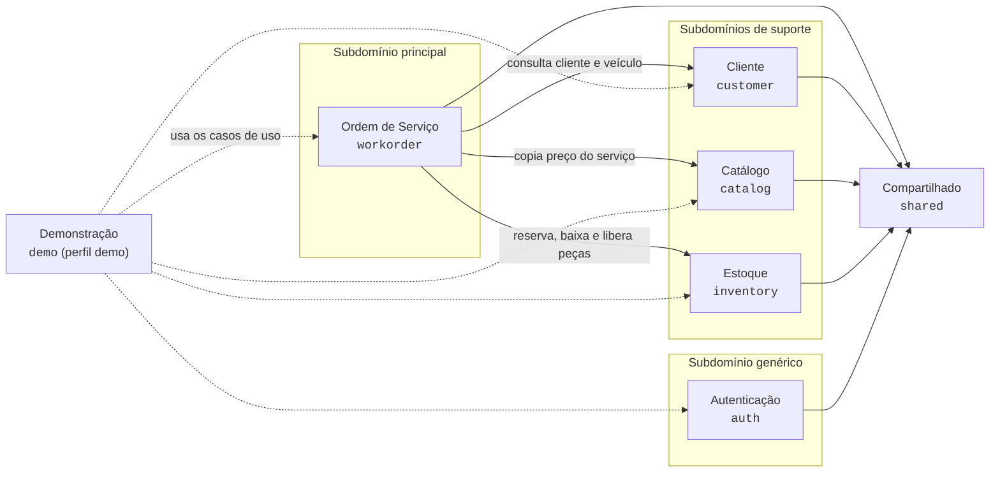
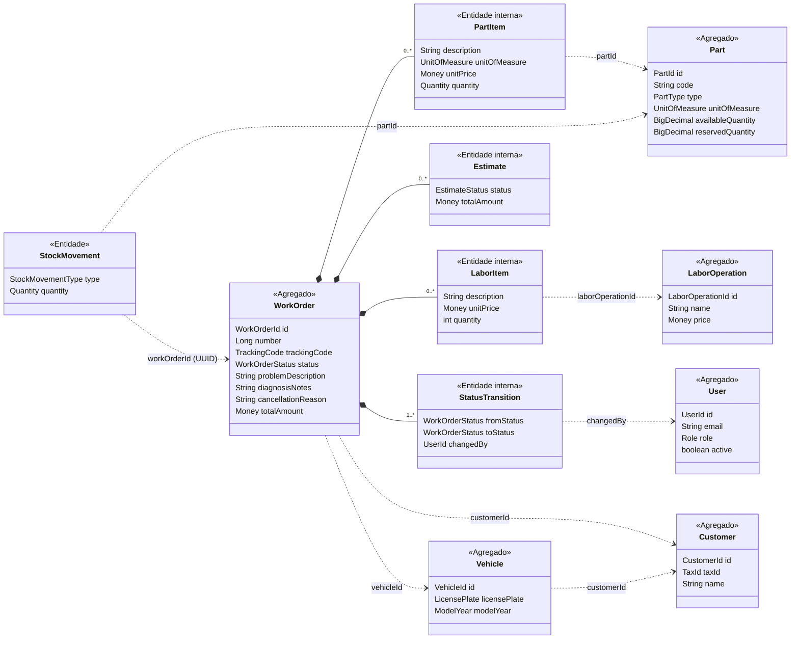
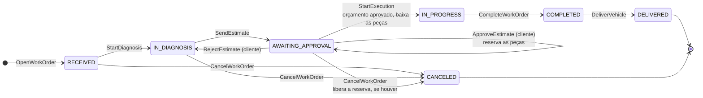
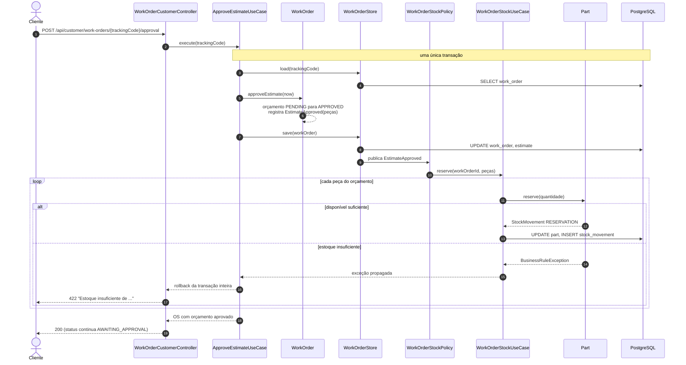
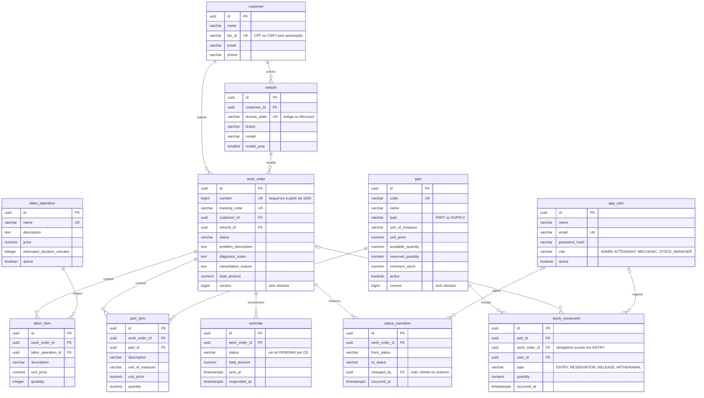

# Diagramas

Diagramas da solução em Mermaid (renderizados pelo GitHub). Os termos seguem a [linguagem ubíqua](linguagem-ubiqua.md).

1. [Mapa de contextos](#1-mapa-de-contextos)
2. [Agregados e referências por ID](#2-agregados-e-referências-por-id)
3. [Ciclo de vida da ordem de serviço](#3-ciclo-de-vida-da-ordem-de-serviço)
4. [Aprovação do orçamento com reserva de estoque](#4-aprovação-do-orçamento-com-reserva-de-estoque)
5. [Modelo de entidades e relacionamentos](#5-modelo-de-entidades-e-relacionamentos)

---

## 1. Mapa de contextos

Dependências entre os módulos, conforme a verificação do Spring Modulith (`ModularityTests`). As setas apontam para
o contexto usado. Não há ciclos: o build falha se surgir algum.

- `workorder` guarda apenas IDs de cliente, veículo, serviço e peça, e copia descrição e preço no momento da inclusão.
- O estoque não conhece a OS (guarda o ID dela como `UUID`): a política de estoque fica em `workorder` e aciona o
  `WorkOrderStockUseCase`.
- Nenhum contexto de negócio depende de `auth`: quem executou cada ação é guardado como `UserId`, de `shared`.
- O diagrama C4 gerado pelo Modulith fica em `target/spring-modulith-docs/components.puml` após `./mvnw test`.

## 2. Agregados e referências por ID

Cada agregado é uma fronteira de consistência. Entre agregados a referência é sempre pelo ID tipado; só as entidades
internas da `WorkOrder` (itens, orçamentos e transições) são gravadas junto com ela.

Linha cheia com losango: composição dentro do agregado. Linha tracejada: referência por ID, sem carregar o objeto.

## 3. Ciclo de vida da ordem de serviço

Cada transição gera um `StatusTransition` e um evento de domínio. O status nunca é alterado diretamente.

| Status | Rótulo | Na fila de OS em andamento |
|---|---|---|
| `IN_PROGRESS` | Em execução | 1º |
| `AWAITING_APPROVAL` | Aguardando aprovação | 2º |
| `IN_DIAGNOSIS` | Em diagnóstico | 3º |
| `RECEIVED` | Recebida | 4º |
| `COMPLETED` | Finalizada | fora da fila |
| `DELIVERED` | Entregue | fora da fila |
| `CANCELED` | Cancelada | fora da fila |

- Serviços e peças só entram ou saem em `IN_DIAGNOSIS`.
- O cancelamento é feito só pela equipe, com motivo obrigatório; a partir de `IN_PROGRESS` não é mais permitido.
- `DELIVERED` e `CANCELED` são finais. Um veículo só recebe nova OS quando a anterior está em um deles.

## 4. Aprovação do orçamento com reserva de estoque

A política de estoque reage ao evento de forma síncrona, na mesma transação. Se faltar estoque, a transação inteira é
desfeita: o orçamento continua pendente e o cliente recebe o motivo.

O mesmo padrão vale para `ExecutionStarted` (baixa das peças reservadas) e `WorkOrderCanceled` (liberação da
reserva quando o orçamento já estava aprovado).

## 5. Modelo de entidades e relacionamentos

Tabelas criadas pelo Flyway (`src/main/resources/db/migration`). Status e tipos são `VARCHAR` com `CHECK`; valores
monetários são `NUMERIC(12,2)` e quantidades `NUMERIC(12,3)`.

Todas as tabelas têm também `created_at` e `updated_at` (exceto as filhas da OS e o extrato, que têm data própria).
A tabela `event_publication` (V2) é do Spring Modulith e não faz parte do modelo de negócio.
